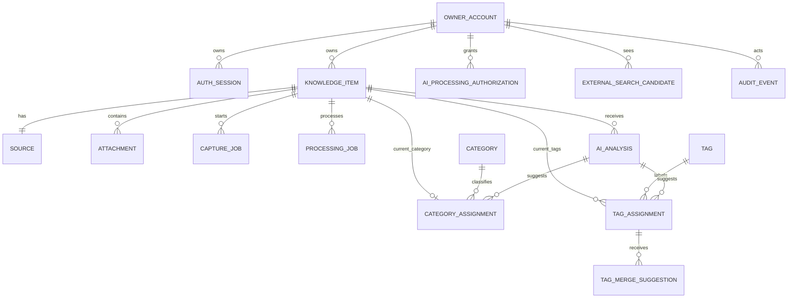

# Phase 1 Data Model: AI 个人知识库

**Feature**: `001-ai-personal-knowledge-base`

**Date**: 2026-10-21

**Database**: PostgreSQL 18

## Conventions

- Primary keys are UUIDs generated server-side.
- Timestamps use `timestamptz` and are stored in UTC.
- All mutable business rows carry `version integer NOT NULL DEFAULT 1` for optimistic
  concurrency unless the row is append-only.
- `owner_id` is retained on owner-scoped data for explicit access checks, but the product is
  constrained to one owner.
- Enum values are implemented as PostgreSQL enums or checked text columns. State transitions
  are enforced in the domain layer and tested at the database boundary.
- JSONB stores only validated, schema-versioned projections. Raw provider responses, raw
  secrets, and unbounded extracted content are not stored.

## Relationship Overview



## Entity: Owner Account

**Purpose**: Represents the sole private owner.

**Implementation note**: Use Better Auth's Drizzle schema and extend its user record with
`instance_key`, `locale`, and application profile fields. Session and credential tables remain
owned by Better Auth but must use hashed tokens and database sessions.

| Field | Type | Rules |
|-------|------|-------|
| `id` | uuid | Primary key |
| `instance_key` | smallint | Fixed value `1`; unique |
| `email_normalized` | citext | Unique, required, normalized |
| `locale` | text | `zh-CN` or `en`; default `zh-CN` |
| `created_at` | timestamptz | Required |
| `updated_at` | timestamptz | Required |
| `version` | integer | Optimistic concurrency |

**Constraints**:

- `UNIQUE(instance_key)` prevents a second owner.
- `UNIQUE(email_normalized)` prevents duplicate identities.
- Public registration is disabled after bootstrap.

## Entity: Authentication Session

**Purpose**: Represents an authenticated browser session.

| Field | Type | Rules |
|-------|------|-------|
| `id` | uuid | Primary key |
| `owner_id` | uuid | FK to owner, `ON DELETE CASCADE` |
| `token_hash` | text | Unique; never store the raw session token |
| `created_at` | timestamptz | Required |
| `last_seen_at` | timestamptz | Updated with throttling |
| `expires_at` | timestamptz | Required |
| `revoked_at` | timestamptz | Nullable |

**Indexes**:

- `UNIQUE(token_hash)`
- `(owner_id, expires_at) WHERE revoked_at IS NULL`

## Entity: Knowledge Item

**Purpose**: The primary searchable unit.

| Field | Type | Rules |
|-------|------|-------|
| `id` | uuid | Primary key |
| `owner_id` | uuid | FK to owner, `ON DELETE RESTRICT` |
| `title` | text | Required, trimmed, 1–300 characters |
| `body` | text | Redacted text; may be empty during extraction |
| `note` | text | User-authored, redacted text |
| `processing_status` | enum | See processing state |
| `processing_error_code` | text | Safe code only |
| `tags_locked` | boolean | Default false; supports locking an intentionally empty tag set |
| `redaction_applied` | boolean | Default false |
| `redaction_count` | integer | Non-negative; counts redacted regions, not values |
| `lifecycle_state` | enum | `active`, `recycled`, `purging` |
| `deleted_at` | timestamptz | Required when recycled or purging |
| `purge_after` | timestamptz | Required when recycled or purging |
| `search_revision` | integer | Incremented when searchable fields change |
| `indexed_revision` | integer | Last Meilisearch revision acknowledged |
| `created_at` | timestamptz | Required |
| `updated_at` | timestamptz | Required |
| `version` | integer | Optimistic concurrency |

**Searchable projection fields**:

- `title`
- `body`
- `note`
- current category display name
- current tag display names
- generated summary

`processing_status` never filters the default search. An item with pending, provisional, or
failed processing remains searchable while active.

## Entity: Source

**Purpose**: Describes where the knowledge came from.

| Field | Type | Rules |
|-------|------|-------|
| `id` | uuid | Primary key |
| `item_id` | uuid | FK to item, `ON DELETE CASCADE`; unique for V1 |
| `kind` | enum | `manual`, `pasted_text`, `webpage`, `document`, `screenshot`, `internet_search` |
| `url_sanitized` | text | Nullable; fragment removed; must pass URL safety checks |
| `url_host` | text | Nullable; normalized host |
| `url_sha256` | char(64) | Nullable; used for duplicate hints, not raw-token search |
| `provider` | text | Nullable; for example `deepseek-search` |
| `external_result_id` | text | Nullable; provider result reference |
| `captured_at` | timestamptz | Required for external sources |
| `created_at` | timestamptz | Required |

**Constraints**:

- `UNIQUE(item_id)` for V1 because each item has one primary source.
- Reject URLs with embedded credentials or non-public targets before insert.
- Do not store cookies, authorization headers, or full provider responses.

## Entity: Attachment

**Purpose**: Stores an object-store file and its safety state.

| Field | Type | Rules |
|-------|------|-------|
| `id` | uuid | Primary key |
| `item_id` | uuid | FK to item, `ON DELETE CASCADE` |
| `source_id` | uuid | FK to source, nullable, `ON DELETE SET NULL` |
| `kind` | enum | `document`, `image`, `screenshot`, `derived_redacted_image` |
| `storage_key` | text | Unique, non-guessable S3 key |
| `filename_display` | text | Sanitized display name; not used in logs |
| `media_type` | text | Detected MIME, not extension-only |
| `size_bytes` | bigint | Non-negative |
| `sha256` | char(64) | Content digest |
| `scan_state` | enum | `pending`, `clean`, `rejected` |
| `redaction_state` | enum | `none`, `redacted`, `not_required`, `rejected` |
| `derived_from_attachment_id` | uuid | Self-FK, nullable |
| `storage_state` | enum | `staged`, `stored`, `deleting`, `deleted` |
| `created_at` | timestamptz | Required |
| `updated_at` | timestamptz | Required |

**Rules**:

- A rejected attachment does not create a durable attachment row or S3 object.
- Staging artifacts use a restricted temporary bucket and expire automatically.
- An image containing a secret is replaced by a redacted derived image; the original is never
  promoted to durable storage.
- If complete scanning or redaction is uncertain, the request fails and all staging artifacts
  are deleted.

## Entity: Capture Job

**Purpose**: Tracks user-initiated import and extraction work.

| Field | Type | Rules |
|-------|------|-------|
| `id` | uuid | Primary key |
| `owner_id` | uuid | FK to owner |
| `item_id` | uuid | FK to item, `ON DELETE CASCADE` |
| `source_id` | uuid | FK to source, nullable |
| `kind` | enum | `text`, `document`, `screenshot`, `webpage` |
| `content_type` | enum | `text`, `document`, `image`, `webpage` |
| `status` | enum | `queued`, `running`, `blocked_authorization`, `succeeded`, `failed`, `cancelled` |
| `attempt_count` | integer | Default 0 |
| `scheduled_at` | timestamptz | Required |
| `started_at` | timestamptz | Nullable |
| `finished_at` | timestamptz | Nullable |
| `lease_expires_at` | timestamptz | Nullable |
| `error_code` | text | Safe code only |
| `error_message_safe` | text | No content, URL credentials, filename, or provider body |
| `idempotency_key` | text | Stable per owner/action |
| `version` | integer | Optimistic concurrency |

**Constraint**: `UNIQUE(owner_id, idempotency_key)`.

## Entity: Processing Job

**Purpose**: Tracks classification, OCR, provider calls, and indexing work.

| Field | Type | Rules |
|-------|------|-------|
| `id` | uuid | Primary key |
| `owner_id` | uuid | FK to owner |
| `item_id` | uuid | FK to item, `ON DELETE CASCADE` |
| `capture_job_id` | uuid | Nullable FK to capture job |
| `kind` | enum | `extract`, `ocr`, `classify`, `index`, `redact_image`, `purge` |
| `service_code` | text | Enum-like provider identifier |
| `content_type` | enum | `text`, `document`, `image`, `webpage`, `internet_result` |
| `authorization_id` | uuid | Nullable FK to authorization, `ON DELETE RESTRICT` |
| `content_hash` | char(64) | Hash of the exact approved payload |
| `explicit_confirmation_at` | timestamptz | Required for external calls |
| `status` | enum | `queued`, `running`, `blocked_authorization`, `succeeded`, `failed`, `cancelled` |
| `attempt_count` | integer | Default 0 |
| `scheduled_at` | timestamptz | Required |
| `started_at` | timestamptz | Nullable |
| `finished_at` | timestamptz | Nullable |
| `lease_expires_at` | timestamptz | Nullable |
| `error_code` | text | Safe code only |
| `error_message_safe` | text | No user content |
| `idempotency_key` | text | Stable per item revision and task type |
| `version` | integer | Optimistic concurrency |

**Constraint**: `UNIQUE(owner_id, idempotency_key)`.

## Entity: AI Analysis

**Purpose**: Stores validated analysis output, not raw model responses.

| Field | Type | Rules |
|-------|------|-------|
| `id` | uuid | Primary key |
| `owner_id` | uuid | FK to owner |
| `item_id` | uuid | FK to item, `ON DELETE CASCADE` |
| `processing_job_id` | uuid | Nullable FK, unique |
| `service_code` | text | Provider identifier |
| `model_id` | text | Exact model/version used |
| `prompt_version` | text | Reproducibility identifier |
| `content_type` | enum | Same enum as processing job |
| `input_hash` | char(64) | Hash of redacted approved input |
| `output_language` | text | `zh-CN` or `en` |
| `confidence_threshold` | numeric(4,3) | Active threshold at analysis time |
| `status` | enum | `succeeded`, `partial`, `failed` |
| `summary` | text | Redacted and validated |
| `structured_result` | jsonb | Versioned schema containing categories, tags, confidence, related IDs |
| `result_schema_version` | integer | Required |
| `created_at` | timestamptz | Required |

**Rules**:

- Never persist raw prompts or unvalidated model output.
- Related-item IDs must reference active owner items or be discarded.
- A late result is ignored if `input_hash` does not match the current redacted revision.

## Entity: Category

**Purpose**: Shared, automatically generated classification vocabulary.

| Field | Type | Rules |
|-------|------|-------|
| `id` | uuid | Primary key |
| `canonical_key` | text | Unique normalized key |
| `display_name` | text | User-visible label |
| `language_code` | text | `zh-CN`, `en`, or neutral |
| `status` | enum | `active`, `merged`, `retired` |
| `merged_into_id` | uuid | Self-FK, nullable |
| `created_at` | timestamptz | Required |
| `updated_at` | timestamptz | Required |
| `version` | integer | Optimistic concurrency |

Category rows do not contain per-item locks.

## Entity: Tag

**Purpose**: Shared normalized tag vocabulary.

| Field | Type | Rules |
|-------|------|-------|
| `id` | uuid | Primary key |
| `canonical_key` | text | Unique normalized key |
| `display_name` | text | User-visible label |
| `language_code` | text | `zh-CN`, `en`, or neutral |
| `status` | enum | `active`, `merged`, `retired` |
| `merged_into_id` | uuid | Self-FK, nullable |
| `created_at` | timestamptz | Required |
| `updated_at` | timestamptz | Required |
| `version` | integer | Optimistic concurrency |

Tag rows do not contain per-item locks.

## Entity: Category Assignment

**Purpose**: Current item-level classification with lock and review state.

| Field | Type | Rules |
|-------|------|-------|
| `id` | uuid | Primary key |
| `item_id` | uuid | FK to item, `ON DELETE CASCADE` |
| `category_id` | uuid | Nullable FK, `ON DELETE RESTRICT`; null means intentionally uncategorized |
| `status` | enum | `provisional`, `applied`, `locked`, `superseded` |
| `confidence` | numeric(4,3) | Nullable for user-only assignments |
| `origin` | enum | `ai`, `user`, `system` |
| `analysis_id` | uuid | Nullable FK to AI analysis |
| `assigned_at` | timestamptz | Required |
| `locked_at` | timestamptz | Required when status is `locked` |
| `superseded_at` | timestamptz | Nullable |
| `version` | integer | Optimistic concurrency |

**Constraint**: At most one current assignment:

```text
UNIQUE(item_id) WHERE superseded_at IS NULL
```

## Entity: Tag Assignment

**Purpose**: Current item-level tag assignments with lock and review state.

| Field | Type | Rules |
|-------|------|-------|
| `id` | uuid | Primary key |
| `item_id` | uuid | FK to item, `ON DELETE CASCADE` |
| `tag_id` | uuid | FK to tag, `ON DELETE RESTRICT` |
| `status` | enum | `provisional`, `applied`, `locked`, `superseded` |
| `confidence` | numeric(4,3) | Nullable for user-only assignments |
| `origin` | enum | `ai`, `user`, `system` |
| `analysis_id` | uuid | Nullable FK to AI analysis |
| `assigned_at` | timestamptz | Required |
| `locked_at` | timestamptz | Required when status is `locked` |
| `superseded_at` | timestamptz | Nullable |
| `version` | integer | Optimistic concurrency |

**Constraint**:

```text
UNIQUE(item_id, tag_id) WHERE superseded_at IS NULL
```

`knowledge_item.tags_locked = true` records the intentionally empty locked tag set.

## Entity: Tag Merge Suggestion

**Purpose**: Presents normalization proposals without changing locked item fields.

| Field | Type | Rules |
|-------|------|-------|
| `id` | uuid | Primary key |
| `item_id` | uuid | FK to item, `ON DELETE CASCADE` |
| `tag_assignment_id` | uuid | FK to assignment, `ON DELETE CASCADE` |
| `source_tag_id` | uuid | FK to tag |
| `target_tag_id` | uuid | FK to tag |
| `reason_code` | text | Safe enum-like reason |
| `status` | enum | `pending`, `accepted`, `rejected`, `expired` |
| `created_at` | timestamptz | Required |
| `resolved_at` | timestamptz | Nullable |

Only suggestions can be created for locked assignments. Applying one requires an explicit user
action that creates a new locked assignment and supersedes the old one.

## Entity: AI Processing Authorization

**Purpose**: Records explicit consent by service and content type.

| Field | Type | Rules |
|-------|------|-------|
| `id` | uuid | Primary key |
| `owner_id` | uuid | FK to owner, `ON DELETE CASCADE` |
| `service_code` | text | Provider/service identifier |
| `content_type` | enum | `text`, `document`, `image`, `webpage`, `internet_result` |
| `purpose` | text | Controlled value such as `classify`, `search`, `fetch`, `vision` |
| `consent_text_version` | text | Version of disclosed purpose text |
| `granted_at` | timestamptz | Required |
| `revoked_at` | timestamptz | Nullable |
| `version` | integer | Optimistic concurrency |

**Constraint**:

```text
UNIQUE(owner_id, service_code, content_type, purpose)
WHERE revoked_at IS NULL
```

Re-authorization creates a new row. Revocation does not delete existing knowledge or analysis.

## Entity: External Search Candidate

**Purpose**: Holds short-lived internet results that are not knowledge items.

| Field | Type | Rules |
|-------|------|-------|
| `id` | uuid | Primary key |
| `owner_id` | uuid | FK to owner |
| `session_id` | uuid | Opaque current search session |
| `provider` | text | Search provider identifier |
| `title` | text | Provider title, sanitized for display |
| `url` | text | Public URL, sanitized |
| `snippet` | text | Short provider snippet |
| `rank` | integer | Provider order |
| `expires_at` | timestamptz | Default now + 15 minutes |
| `created_at` | timestamptz | Required |

**Rules**:

- No `knowledge_item`, `source`, attachment, or search document is created before confirmation.
- Rows are not exposed as search history.
- Expired rows are purged periodically and can be cleaned at confirmation time.
- Saving a candidate is idempotent using a candidate ID plus owner ID.

## Entity: Audit Event

**Purpose**: Records safe operational facts after business rows are deleted.

| Field | Type | Rules |
|-------|------|-------|
| `id` | bigint | Identity primary key |
| `actor_type` | enum | `owner`, `system` |
| `actor_id` | uuid | Nullable |
| `action` | text | Enum-like action code |
| `entity_type` | text | Controlled entity name |
| `entity_id` | uuid | Nullable |
| `correlation_id` | uuid | Request/job correlation |
| `metadata_safe` | jsonb | No content, URLs with credentials, filenames, or secrets |
| `occurred_at` | timestamptz | Required |

No business foreign keys are attached, so hard deletion does not remove audit facts.

## State Machines

### Item Lifecycle

```text
active -> recycled -> purging -> hard deleted
recycled -> active
```

- `active` is searchable.
- `recycled` is not searchable and is visible only in the trash.
- `purging` cannot be restored.
- Deletion clears the search projection immediately.

### Item Processing

```text
not_requested -> pending -> running -> succeeded
                         -> partial
                         -> failed
pending -> awaiting_authorization
failed -> pending                 (retry)
pending/running -> cancelled
```

Every state remains searchable while `lifecycle_state = active`.

### Job

```text
queued -> running -> succeeded
                  -> failed
                  -> cancelled
queued/running -> blocked_authorization
retryable failed -> queued
```

### Classification Assignment

```text
provisional -> locked
applied     -> locked
provisional -> superseded
applied     -> superseded
locked      -> superseded         (only by an explicit user edit)
```

AI and normalization jobs can modify only `provisional` or `applied` current assignments.

### Authorization

```text
active -> revoked
```

Revocation applies to future jobs only.

## Search Index Projection

Each Meilisearch document contains:

```json
{
  "id": "uuid",
  "title": "redacted title",
  "body": "redacted body",
  "note": "redacted note",
  "summary": "redacted summary",
  "category_names": ["category"],
  "tag_names": ["tag"],
  "source_type": "manual",
  "lifecycle_state": "active",
  "search_revision": 4,
  "updated_at": "2026-10-21T00:00:00Z"
}
```

The index never contains attachment bytes, raw URLs with sensitive query data, provider
credentials, authorization records, or deleted-item content.

## Required Indexes

- Active knowledge ordering: `(owner_id, updated_at DESC) WHERE lifecycle_state = 'active'`.
- Processing panel: `(owner_id, processing_status, updated_at DESC) WHERE lifecycle_state = 'active'`.
- Purge scheduler: `(lifecycle_state, purge_after)`.
- Job leasing: `(status, scheduled_at)`, `(lease_expires_at)` partial for queued/running.
- Current category: `(category_id) WHERE superseded_at IS NULL`.
- Current tags: `(tag_id) WHERE superseded_at IS NULL`.
- Pending review: `(status) WHERE superseded_at IS NULL AND status IN ('provisional')`.
- Duplicate source hints: `source(url_sha256)`.
- Attachments: `(item_id)`, `(sha256)`, `(storage_state)`.
- External candidates: `(owner_id, session_id, expires_at)`.
- Audit: `(entity_type, entity_id, occurred_at DESC)` and `(occurred_at)`.

## Retention and Deletion

| Data | Default |
|------|---------|
| Active knowledge | Until user deletion |
| Recycle bin | 30 days |
| Daily database backup | 30 days |
| WAL/PITR | 7 days |
| Search candidates | 15 minutes |
| Processing jobs | 90 days |
| Audit events | 365 days |
| Authorization history | Account lifetime |

Permanent deletion order:

1. Stop or cancel related jobs.
2. Mark the item `purging`.
3. Remove Meilisearch documents.
4. Delete S3 objects and verify completion.
5. Hard-delete the knowledge item and cascading business rows.
6. Record a safe audit event.

If object deletion fails, the database row remains `purging` and the task retries.

## Critical Invariants

1. Accepted manual and AI imports are `active` and searchable immediately.
2. Search results never include non-active items, even when an index is stale.
3. Internet candidates create no knowledge rows before confirmation.
4. One current category and multiple current tags are allowed per item.
5. User edits create locked item-level assignments; shared vocabulary rows remain unlocked.
6. AI cannot overwrite locked assignments or a newer item revision.
7. Every external AI call requires an active matching service/content-type authorization.
8. High-confidence secrets never enter durable text, indexes, logs, or object storage.
9. Unscannable content is rejected before durable persistence.
10. Expired recycled items cannot be restored from current data or old backups.
