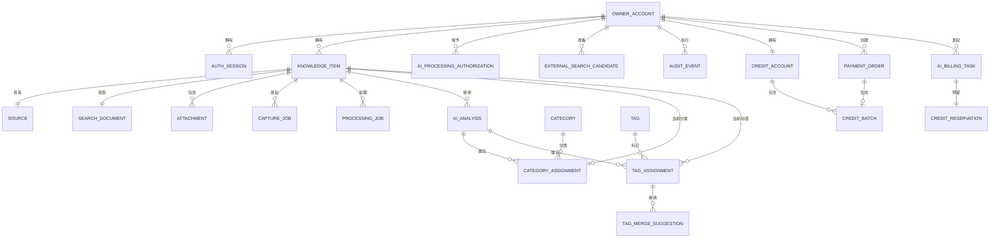

# 阶段 1 数据模型：AI 个人知识库

**特性**：`001-ai-personal-knowledge-base`

**日期**：2026-10-21

**数据库**：PostgreSQL 18

## 约定

- 主键为服务端生成的 UUID。
- 时间戳使用 `timestamptz`，并以 UTC 存储。
- 除仅追加的行外，所有可变业务行都包含 `version integer NOT NULL DEFAULT 1`，用于乐观
  并发控制。
- `owner_id` 是兼容字段名，语义为账号 ID。它只从已认证会话取得，用于隔离知识、附件、上传、
  搜索、会话、点数、订单和账本；客户端不得覆盖。系统支持多个独立账号，但不提供团队空间、
  跨账号共享或转赠。
- 枚举值由 PostgreSQL 枚举或带检查约束的文本列实现。状态转换在领域层强制执行，并在
  数据库边界进行测试。
- JSONB 仅存储经过验证且带模式版本的投影。不存储原始提供商响应、原始密钥或无界提取
  内容。

## 关系概览



关系图中的 `OWNER_ACCOUNT` / `owner_account` 是既有兼容名称，逻辑实体为“账号”，不得解释为
实例唯一所有者。

## 实体：账号（兼容表 `owner_account`）

**用途**：表示一个可独立登录并隔离数据的账号。

**实现说明**：使用 Spring Security 凭据模型、公开邮箱验证注册和 Spring Session JDBC。
`owner_account` 作为兼容表名保存账号和密码哈希；会话表由 Spring Session 管理。密码使用
BCrypt 或 Argon2 强哈希。注册只要求邮箱验证码、两次一致密码、60 秒发码冷却、频控和临时
邮箱域名拒绝，不要求图形验证码；已有账号不关闭注册。

| 字段 | 类型 | 规则 |
|-------|------|-------|
| `id` | uuid | 主键 |
| `email_normalized` | text | 唯一、必填、已小写规范化 |
| `email_verified_at` | timestamptz | 通过邮箱验证码确认后必填 |
| `password_hash` | text | BCrypt 或 Argon2 强哈希；不得保存明文 |
| `locale` | text | `zh-CN` 或 `en`；默认 `zh-CN` |
| `created_at` | timestamptz | 必填 |
| `updated_at` | timestamptz | 必填 |
| `version` | integer | 乐观并发控制 |

**约束**：

- `UNIQUE(email_normalized)` 防止同一邮箱重复注册。
- 可创建多个账号；不得用实例级唯一键限制账号数量。
- 邮箱验证、60 秒发码冷却、频控和临时邮箱域名拒绝必须通过后才能创建账号。

## 临时安全状态：注册邮箱验证码

**用途**：在不新增业务表的前提下，限制账号注册的邮箱验证和发送频率。

**实现说明**：使用有界 Caffeine 缓存保存邮箱验证码哈希、随机盐、过期时间、尝试次数、发送冷却
和 IP 频率窗口。验证码永远不进入知识内容、数据库业务表、日志或生产响应。

| 状态 | 规则 |
|------|------|
| 验证码 | 6 位密码学随机数字；SHA-256 + 随机盐存储 |
| 有效期 | 默认 10 分钟；应用重启后全部失效 |
| 尝试次数 | 最多 5 次；成功或达到上限后移除 |
| 重发 | 同一邮箱 60 秒冷却；新码覆盖旧码并立即使旧码失效 |
| 频率 | 每邮箱每小时 5 次；每 IP 每小时 20 次 |
| 屏蔽域名 | 版本化清单；精确域名或子域边界匹配 |

缓存是大规模部署前的单实例安全状态；多实例时必须改为共享缓存或有粘性路由，且不得放宽
一次性消费和尝试次数限制。

## 实体：认证会话（Spring Session JDBC）

**用途**：表示已认证的浏览器会话。会话主表、属性和过期索引由 Spring Session JDBC 管理，
应用只保存账号 principal 和必要的安全元数据。

| 字段 | 类型 | 规则 |
|-------|------|-------|
| `primary_id` | char(36) | Spring Session 主键 |
| `session_id` | char(36) | 唯一会话标识 |
| `owner_id` | uuid | 账号 ID（兼容字段名），`ON DELETE CASCADE` |
| `creation_time` | bigint | Spring Session 时间 |
| `last_access_time` | bigint | 最后访问时间 |
| `max_inactive_interval` | integer | 最大空闲秒数 |
| `expiry_time` | bigint | 绝对过期时间 |
| `principal_name` | text | 账号 principal |
| `attributes_json` | text | Spring Session 序列化属性，不得保存密码或密钥 |

**索引**：

- `UNIQUE(session_id)`。
- `(owner_id, expiry_time)`。
- `(expiry_time)` 用于过期清理。

## 实体：知识条目

**用途**：主要可搜索单元。

| 字段 | 类型 | 规则 |
|-------|------|-------|
| `id` | uuid | 主键 |
| `owner_id` | uuid | 账号 ID（兼容字段名），`ON DELETE RESTRICT` |
| `title` | text | 必填、去除首尾空白，长度 1–300 个字符 |
| `body` | text | 已脱敏文本；提取期间可以为空 |
| `body_migration_state` | enum | `not_required`、`pending`、`completed`、`failed`；控制旧纯文本到富文本的过渡 |
| `note` | text | 用户编写并已脱敏的文本 |
| `processing_status` | enum | 参见处理状态 |
| `processing_error_code` | text | 仅允许安全代码 |
| `tags_locked` | boolean | 默认 false；支持锁定有意为空的标签集 |
| `redaction_applied` | boolean | 默认 false |
| `redaction_count` | integer | 非负数；统计已脱敏区域的数量，而不是值的数量 |
| `lifecycle_state` | enum | `active`、`recycled`、`purging` |
| `deleted_at` | timestamptz | 处于 recycled 或 purging 时必填 |
| `purge_after` | timestamptz | 处于 recycled 或 purging 时必填 |
| `search_revision` | integer | 可搜索字段变更时递增 |
| `indexed_revision` | integer | 最近一次确认的 PostgreSQL 搜索投影修订版本 |
| `created_at` | timestamptz | 必填 |
| `updated_at` | timestamptz | 必填 |
| `version` | integer | 乐观并发控制 |

**可搜索投影字段**：

- `title`
- `body`
- `note`
- 当前分类显示名称
- 当前标签显示名称
- 生成的摘要

`processing_status` 从不作为默认搜索的过滤条件。只要条目处于 active 状态，即使处理正在
等待、暂定或已失败，仍然可被搜索。

### 富文本正文扩展

功能 [004 富文本编辑器](../004-rich-text-editor/data-model.md) 在保留 `body` 纯文本投影的
基础上增加一对一 `rich_document`：

| 关系 | 规则 |
|------|------|
| `knowledge_item` 1:1 `rich_document` | 结构化正文、schema 版本、图片引用和纯文本投影 |
| `rich_document` 1:N `rich_image_reference` | 只引用已完成扫描和脱敏的附件 |
| `rich_document` 1:N `rich_document_revision` | 保留有限修订窗口，支持冲突和迁移 |

详细字段、图片配额、状态和不变量由 004 数据模型定义。搜索索引和 AI 输入继续使用
`knowledge_item.body` 的纯文本投影，不读取结构化 JSON 或附件存储键。

迁移状态为 `pending` 或 `failed` 时，API 返回 `bodyDocument=null`，客户端只能以 `body`
只读过渡并提示迁移状态；迁移完成后才开放富文本编辑。列表和搜索结果使用不含完整
`bodyDocument` 的摘要 DTO，避免分页响应携带大正文。

## 实体：来源

**用途**：描述知识的来源。

| 字段 | 类型 | 规则 |
|-------|------|-------|
| `id` | uuid | 主键 |
| `item_id` | uuid | 指向条目的外键，`ON DELETE CASCADE`；V1 中唯一 |
| `kind` | enum | `manual`、`pasted_text`、`webpage`、`document`、`screenshot`、`internet_search` |
| `input_method` | enum | `manual`、`clipboard`、`file_upload`、`page_capture`、`api` |
| `url_sanitized` | text | 可为空；已移除片段标识；必须通过 URL 安全检查 |
| `url_host` | text | 可为空；已规范化主机名 |
| `url_sha256` | char(64) | 可为空；用于重复提示，不用于原始令牌搜索 |
| `provider` | text | 可为空；例如 `deepseek-search` |
| `external_result_id` | text | 可为空；提供商结果引用 |
| `captured_at` | timestamptz | 外部来源必填 |
| `created_at` | timestamptz | 必填 |

**约束**：

- V1 中使用 `UNIQUE(item_id)`，因为每个条目只有一个主要来源。
- 插入前拒绝包含内嵌凭据或指向非公开目标的 URL。
- `text` 来源只用于独立 AI 文字入口；`screenshot` 来源只能使用 `clipboard`；`document`
  来源可表示文档或文档入口图片。文档图片必须先经 OCR 和 AI 整理，不得直接生成附件型知识。
- 不存储 Cookie、`Authorization` 请求头或完整提供商响应。

## 实体：附件

**用途**：存储对象存储中的文件及其安全状态。

| 字段 | 类型 | 规则 |
|-------|------|-------|
| `id` | uuid | 主键 |
| `owner_id` | uuid | 账号 ID（兼容字段名），`ON DELETE CASCADE` |
| `item_id` | uuid | 指向条目的外键，`ON DELETE CASCADE` |
| `source_id` | uuid | 指向来源的外键，可为空，`ON DELETE SET NULL` |
| `kind` | enum | `document`、`image`、`screenshot`、`derived_redacted_image` |
| `storage_key` | text | 唯一且不可猜测的 S3 键 |
| `filename_display` | text | 已清理的显示名称；不用于日志 |
| `media_type` | text | 检测得到的 MIME 类型，而非仅依据扩展名 |
| `size_bytes` | bigint | 非负数 |
| `sha256` | char(64) | 内容摘要 |
| `scan_state` | enum | `pending`、`clean`、`rejected` |
| `redaction_state` | enum | `none`、`redacted`、`not_required`、`rejected` |
| `derived_from_attachment_id` | uuid | 指向自身的外键，可为空 |
| `storage_state` | enum | `staged`、`stored`、`deleting`、`deleted` |
| `created_at` | timestamptz | 必填 |
| `updated_at` | timestamptz | 必填 |

**规则**：

- 被拒绝的附件不会创建持久附件行或 S3 对象。
- 附件必须按 `owner_id` 直接隔离；每次对象读取、签名 URL 生成和删除都必须同时校验账号。
- 暂存产物使用受限的临时存储桶，并会自动过期。
- 包含密钥的图片会替换为脱敏后的派生图片；原始图片绝不会提升到持久存储。
- 如果无法确定扫描或脱敏是否完整，请求将失败，并删除所有暂存产物。

## 实体：采集任务

**用途**：跟踪用户发起的导入和提取工作。

| 字段 | 类型 | 规则 |
|-------|------|-------|
| `id` | uuid | 主键 |
| `owner_id` | uuid | 账号 ID（兼容字段名） |
| `item_id` | uuid | 指向条目的外键，`ON DELETE CASCADE` |
| `source_id` | uuid | 指向来源的外键，可为空 |
| `kind` | enum | `text`、`document`、`image_file`、`screenshot`、`webpage` |
| `content_type` | enum | `text`、`document`、`image`、`webpage` |
| `status` | enum | `queued`、`running`、`blocked_authorization`、`blocked_billing`、`succeeded`、`failed`、`cancelled` |
| `attempt_count` | integer | 默认 0 |
| `scheduled_at` | timestamptz | 必填 |
| `started_at` | timestamptz | 可为空 |
| `finished_at` | timestamptz | 可为空 |
| `lease_expires_at` | timestamptz | 可为空 |
| `error_code` | text | 仅允许安全代码 |
| `error_message_safe` | text | 不得包含内容、URL 凭据、文件名或提供商正文 |
| `idempotency_key` | text | 按账号/操作保持稳定 |
| `version` | integer | 乐观并发控制 |
| `created_at` | timestamptz | 必填 |
| `updated_at` | timestamptz | 必填 |

**约束**：`UNIQUE(owner_id, idempotency_key)`。

**输入方式约束**：

- `screenshot` 采集任务只由用户主动粘贴剪贴板图片创建，不设置文件选择器。
- `image_file` 采集任务由文档入口选择 JPG、PNG、WebP 图片创建，必须完成安全检查、OCR 和
  AI 整理后才生成知识，不长期保存原图。
- `webpage` 采集任务由浏览器单页渲染产生，与用户截图入口分开。
- `ai_text` 采集任务由独立 AI 文字入口创建，不得走普通手动知识创建路径。

## 实体：处理任务

**用途**：跟踪分类、OCR、提供商调用和索引工作。

| 字段 | 类型 | 规则 |
|-------|------|-------|
| `id` | uuid | 主键 |
| `owner_id` | uuid | 账号 ID（兼容字段名） |
| `item_id` | uuid | 指向条目的外键，`ON DELETE CASCADE` |
| `capture_job_id` | uuid | 指向采集任务的外键，可为空 |
| `kind` | enum | `extract`、`ocr`、`classify`、`index`、`redact_image`、`purge` |
| `service_code` | text | 类似枚举的提供商标识符 |
| `content_type` | enum | `text`、`document`、`image`、`webpage`、`internet_result` |
| `authorization_id` | uuid | 指向授权的外键，可为空，`ON DELETE RESTRICT` |
| `billing_task_id` | uuid | 指向 002 的 AI 计费任务；付费 AI 必填，非 AI 任务可为空 |
| `content_hash` | char(64) | 精确获批载荷的哈希 |
| `explicit_confirmation_at` | timestamptz | 外部调用必填 |
| `status` | enum | `queued`、`running`、`blocked_authorization`、`blocked_billing`、`succeeded`、`failed`、`cancelled` |
| `attempt_count` | integer | 默认 0 |
| `scheduled_at` | timestamptz | 必填 |
| `started_at` | timestamptz | 可为空 |
| `finished_at` | timestamptz | 可为空 |
| `lease_expires_at` | timestamptz | 可为空 |
| `error_code` | text | 仅允许安全代码 |
| `error_message_safe` | text | 不得包含用户内容 |
| `idempotency_key` | text | 按条目修订版本和任务类型保持稳定 |
| `version` | integer | 乐观并发控制 |
| `created_at` | timestamptz | 必填 |
| `updated_at` | timestamptz | 必填 |

**约束**：`UNIQUE(owner_id, idempotency_key)`。

## 计费集成实体

订单、点数账户、点数批次、账本、AI 报价、预留、退款、支付事件和对账的完整字段与状态机
由 [002 数据模型](../002-ai-credit-billing/data-model.md) 定义。本功能只声明以下集成边界，
不复制计费字段：

| 001 实体 | 002 关系 | 规则 |
|----------|----------|------|
| 账号 | `credit_account` 一对一 | 每个账号拥有且只能访问自己的唯一点数账户 |
| 处理任务 | `ai_billing_task` 多对一 | 付费 AI 必须引用有效计费任务 |
| 知识条目 | `ai_billing_task.item_id` | 任务可关联条目，但账本不随条目硬删除 |
| 采集任务 | `ai_billing_task.job_id` | 同一采集任务可包含多个成功或失败的计费步骤 |
| 外部搜索候选 | `ai_billing_task` | 纯搜索固定 1 点；单次回答另计 2 点，分别报价 |
| 审计事件 | 计费异常/审计 | 业务审计不替代财务账本 |

**强制规则**：

1. 付费 AI 的 `processing_job.billing_task_id` 不得为空。
2. `billing_task_id` 必须属于同一账号，处于 `RESERVED` 或 `RUNNING`，且未过期。
3. 同一处理任务不得复用已结算的计费任务；用户主动重跑必须创建新任务。
4. 计费任务不是有效状态时，处理任务保持 `blocked_billing`，不调用外部 AI。
5. 余额不足返回 `402` 时，知识条目仍可创建并处于可搜索的待整理状态。
6. 点数、订单、退款和账本不得因知识条目、采集任务或处理任务删除而级联删除。

`processing_job.status` 增加一个集成值：

```text
blocked_billing
```

它表示内容已保存，但缺少报价、余额、自动扣点授权或计费服务不可用；恢复余额或授权后可
创建新的计费任务并重新排队。

## 实体：AI 分析

**用途**：存储经过验证的分析输出，而非原始模型响应。

| 字段 | 类型 | 规则 |
|-------|------|-------|
| `id` | uuid | 主键 |
| `owner_id` | uuid | 账号 ID（兼容字段名） |
| `item_id` | uuid | 指向条目的外键，`ON DELETE CASCADE` |
| `processing_job_id` | uuid | 可为空的外键，唯一 |
| `service_code` | text | 提供商标识符 |
| `model_id` | text | 实际使用的精确模型/版本 |
| `prompt_version` | text | 可复现性标识符 |
| `content_type` | enum | 与处理任务相同的枚举 |
| `input_hash` | char(64) | 已脱敏且获批输入的哈希 |
| `output_language` | text | `zh-CN` 或 `en` |
| `confidence_threshold` | numeric(4,3) | 分析时生效的阈值 |
| `status` | enum | `succeeded`、`partial`、`failed` |
| `summary` | text | 已脱敏并经过验证 |
| `structured_result` | jsonb | 带版本的 schema，包含分类、标签、置信度和关联 ID |
| `result_schema_version` | integer | 必填 |
| `created_at` | timestamptz | 必填 |

**规则**：

- 绝不持久化原始提示词或未经验证的模型输出。
- 关联条目 ID 必须引用该账号处于 active 状态的条目，否则应丢弃。
- 如果 `input_hash` 与当前脱敏修订版本不匹配，则忽略迟到的结果。

## 实体：分类

**用途**：共享的自动生成分类词表。

| 字段 | 类型 | 规则 |
|-------|------|-------|
| `id` | uuid | 主键 |
| `canonical_key` | text | 唯一的规范化键 |
| `display_name` | text | 用户可见标签 |
| `language_code` | text | `zh-CN`、`en` 或中性 |
| `status` | enum | `active`、`merged`、`retired` |
| `merged_into_id` | uuid | 指向自身的外键，可为空 |
| `created_at` | timestamptz | 必填 |
| `updated_at` | timestamptz | 必填 |
| `version` | integer | 乐观并发控制 |

分类行不包含按条目设置的锁。

## 实体：标签

**用途**：共享的规范化标签词表。

| 字段 | 类型 | 规则 |
|-------|------|-------|
| `id` | uuid | 主键 |
| `canonical_key` | text | 唯一的规范化键 |
| `display_name` | text | 用户可见标签 |
| `language_code` | text | `zh-CN`、`en` 或中性 |
| `status` | enum | `active`、`merged`、`retired` |
| `merged_into_id` | uuid | 指向自身的外键，可为空 |
| `created_at` | timestamptz | 必填 |
| `updated_at` | timestamptz | 必填 |
| `version` | integer | 乐观并发控制 |

标签行不包含按条目设置的锁。

## 实体：分类分配

**用途**：保存当前条目级分类及其锁定和审核状态。

| 字段 | 类型 | 规则 |
|-------|------|-------|
| `id` | uuid | 主键 |
| `item_id` | uuid | 指向条目的外键，`ON DELETE CASCADE` |
| `category_id` | uuid | 可为空的外键，`ON DELETE RESTRICT`；null 表示有意不分类 |
| `status` | enum | `provisional`、`applied`、`locked`、`superseded` |
| `confidence` | numeric(4,3) | 仅用户分配时可为空 |
| `origin` | enum | `ai`、`user`、`system` |
| `analysis_id` | uuid | 指向 AI 分析的可为空外键 |
| `assigned_at` | timestamptz | 必填 |
| `locked_at` | timestamptz | 状态为 `locked` 时必填 |
| `superseded_at` | timestamptz | 可为空 |
| `version` | integer | 乐观并发控制 |

**约束**：最多只能有一个当前分配：

```text
UNIQUE(item_id) WHERE superseded_at IS NULL
```

## 实体：标签分配

**用途**：保存当前条目级标签分配及其锁定和审核状态。

| 字段 | 类型 | 规则 |
|-------|------|-------|
| `id` | uuid | 主键 |
| `item_id` | uuid | 指向条目的外键，`ON DELETE CASCADE` |
| `tag_id` | uuid | 指向标签的外键，`ON DELETE RESTRICT` |
| `status` | enum | `provisional`、`applied`、`locked`、`superseded` |
| `confidence` | numeric(4,3) | 仅用户分配时可为空 |
| `origin` | enum | `ai`、`user`、`system` |
| `analysis_id` | uuid | 指向 AI 分析的可为空外键 |
| `assigned_at` | timestamptz | 必填 |
| `locked_at` | timestamptz | 状态为 `locked` 时必填 |
| `superseded_at` | timestamptz | 可为空 |
| `version` | integer | 乐观并发控制 |

**约束**：

```text
UNIQUE(item_id, tag_id) WHERE superseded_at IS NULL
```

`knowledge_item.tags_locked = true` 记录有意锁定的空标签集。

## 实体：标签合并建议

**用途**：在不更改已锁定条目字段的情况下提供规范化建议。

| 字段 | 类型 | 规则 |
|-------|------|-------|
| `id` | uuid | 主键 |
| `item_id` | uuid | 指向条目的外键，`ON DELETE CASCADE` |
| `tag_assignment_id` | uuid | 指向分配的外键，`ON DELETE CASCADE` |
| `source_tag_id` | uuid | 指向标签的外键 |
| `target_tag_id` | uuid | 指向标签的外键 |
| `reason_code` | text | 类似枚举的安全原因 |
| `status` | enum | `pending`、`accepted`、`rejected`、`expired` |
| `created_at` | timestamptz | 必填 |
| `resolved_at` | timestamptz | 可为空 |

对于已锁定的分配，只能创建建议。应用建议需要用户显式操作，该操作会创建新的锁定分配并
取代旧分配。

## 实体：AI 处理授权

**用途**：按服务和内容类型记录显式同意。

| 字段 | 类型 | 规则 |
|-------|------|-------|
| `id` | uuid | 主键 |
| `owner_id` | uuid | 账号 ID（兼容字段名），`ON DELETE CASCADE` |
| `service_code` | text | 提供商/服务标识符 |
| `content_type` | enum | `text`、`document`、`image`、`webpage`、`internet_result` |
| `purpose` | text | 受控值，例如 `classify`、`search`、`fetch`、`vision` |
| `consent_text_version` | text | 已披露用途文本的版本 |
| `granted_at` | timestamptz | 必填 |
| `revoked_at` | timestamptz | 可为空 |
| `version` | integer | 乐观并发控制 |

**约束**：

```text
UNIQUE(owner_id, service_code, content_type, purpose)
WHERE revoked_at IS NULL
```

重新授权会创建新行。撤销授权不会删除现有知识或分析。

## 实体：外部搜索候选

**用途**：保存不属于知识条目的短期互联网搜索结果。

| 字段 | 类型 | 规则 |
|-------|------|-------|
| `id` | uuid | 主键 |
| `owner_id` | uuid | 账号 ID（兼容字段名） |
| `session_id` | uuid | 表示当前搜索会话的不透明标识 |
| `provider` | text | 搜索提供商标识符 |
| `title` | text | 提供商标题，已为显示目的清理 |
| `url` | text | 公开 URL，已清理 |
| `snippet` | text | 提供商返回的简短摘要片段 |
| `rank` | integer | 提供商排序 |
| `expires_at` | timestamptz | 默认当前时间加 15 分钟 |
| `saved_item_id` | uuid | 指向知识条目的可为空唯一外键；首次成功保存时设置 |
| `consumed_at` | timestamptz | 可为空；与 `saved_item_id` 同时设置 |
| `created_at` | timestamptz | 必填 |

**规则**：

- 用户单击标有 1 点的互联网搜索入口时，服务端创建 `internet_search` 报价并立即确认；
  这次点击是本次 1 点扣费的明确同意，不得再要求搜索二次确认。若同时选择 AI 回答，报价必须
  显示搜索 1 点与回答 2 点的分项及 3 点上限后再执行。
- 纯搜索完成一次有效查询即按 1 点结算；零结果仍视为已执行。服务未响应、超时或协议错误时
  释放 1 点预留。余额不足时不得调用搜索提供商。
- 确认前不会创建任何 `knowledge_item`、`source`、附件或搜索文档。确认保存时必须先完成
  Fetch、脱敏和 AI 整理；不得直接保存搜索摘要或 Fetch 原文。
- 这些行不会作为搜索历史暴露。
- 过期行会定期清除，并可在确认时清理。
- 使用 `saved_item_id` 保存候选是幂等操作；即使客户端发送不同的幂等键，重复确认也会返回
  已创建的条目。

## 实体：审计事件

**用途**：在业务行删除后记录安全的操作事实。

| 字段 | 类型 | 规则 |
|-------|------|-------|
| `id` | bigint | 标识列主键 |
| `actor_type` | enum | `owner`、`system`；`owner` 为兼容值，语义是账号操作者 |
| `actor_id` | uuid | 可为空 |
| `action` | text | 类似枚举的操作代码 |
| `entity_type` | text | 受控实体名称 |
| `entity_id` | uuid | 可为空 |
| `correlation_id` | uuid | 请求/任务关联标识 |
| `metadata_safe` | jsonb | 不得包含内容、含凭据的 URL、文件名或密钥 |
| `occurred_at` | timestamptz | 必填 |

此处不附加业务外键，因此硬删除不会移除审计事实。

## 实体：请求幂等性

**用途**：为 OpenAPI 的 `Idempotency-Key` 契约持久化写请求幂等性和安全响应重放。

| 字段 | 类型 | 规则 |
|-------|------|-------|
| `id` | uuid | 主键 |
| `owner_id` | uuid | 账号 ID（兼容字段名），`ON DELETE CASCADE` |
| `scope` | text | 路由/操作标识符 |
| `idempotency_key` | text | 客户端提供的键 |
| `request_hash` | char(64) | 方法、路由和已验证请求体的哈希 |
| `status` | enum | `processing`、`completed`、`failed` |
| `response_status` | integer | 完成前可为空 |
| `response_body_safe` | jsonb | 可为空；经过验证的安全响应体 |
| `resource_id` | uuid | 可为空；已创建或受影响的资源 |
| `created_at` | timestamptz | 必填 |
| `expires_at` | timestamptz | 默认当前时间加 24 小时 |

**约束**：`UNIQUE(owner_id, scope, idempotency_key)`。

**规则**：

- 使用相同请求哈希重复提交键时，返回已存储的安全响应。
- 使用不同请求哈希重复提交键时，返回 `409`。
- 超过过期时间窗口的处理记录可经协调后重试。
- 存储的响应绝不包含凭据或原始提供商输出。

## 状态机

### 条目生命周期

```text
active -> recycled -> purging -> 硬删除
recycled -> active
```

- `active` 状态可搜索。
- `recycled` 状态不可搜索，且仅在回收站中可见。
- `purging` 状态不可恢复。
- 删除会立即清除搜索投影。

批量移入回收站不新增表或字段。服务端在一个事务内按稳定 UUID 顺序校验所有条目都属于当前账号，
再逐项执行同一生命周期规则；任意一条不存在、非 active、已被其他请求处理或处理失败时，整批回滚。
成功时所有条目使用同一事务提交新的 `lifecycle_state`、`deleted_at` 和 `purge_after`，搜索投影在
提交后立即排除这些条目。客户端请求通过 `api_idempotency` 按账号和请求哈希重放。

### 条目处理

```text
not_requested -> pending -> running -> succeeded
                         -> partial
                         -> failed
pending -> awaiting_authorization
failed -> pending                 （重试）
pending/running -> cancelled
```

只要 `lifecycle_state = active`，每种状态都保持可搜索。

### 任务

```text
queued -> running -> succeeded
                  -> failed
                  -> cancelled
queued/running -> blocked_authorization
queued/running -> blocked_billing
blocked_billing -> queued        （获得有效计费任务后）
可重试的 failed -> queued
```

付费 AI 任务没有有效 `billing_task_id` 时不得从 `queued` 进入 `running`。

### 分类分配

```text
provisional -> locked
applied     -> locked
provisional -> superseded
applied     -> superseded
locked      -> superseded         （仅限用户显式编辑）
```

AI 和规范化任务只能修改处于 `provisional` 或 `applied` 状态的当前分配。

### 授权

```text
active -> revoked
```

撤销仅对后续任务生效。

## 实体：搜索投影

**用途**：在 PostgreSQL 内保存可重建、已脱敏的单框搜索文本和排名元数据。

| 字段 | 类型 | 规则 |
|------|------|------|
| `item_id` | uuid | 主键，指向 `knowledge_item`，`ON DELETE CASCADE` |
| `owner_id` | uuid | 账号 ID（兼容字段名） |
| `title_text` | text | 已脱敏标题 |
| `body_text` | text | 正文纯文本投影 |
| `note_text` | text | 已脱敏备注 |
| `category_text` | text | 当前分类显示名称 |
| `tag_text` | text | 当前标签显示名称拼接 |
| `image_text` | text | 图片说明和替代文本 |
| `search_text` | text | 上述字段的规范化合并文本 |
| `search_vector` | tsvector | 由 `simple` 配置生成 |
| `search_revision` | integer | 与知识条目修订一致 |
| `updated_at` | timestamptz | 必填 |

**索引**：

- `GIN(search_vector)`。
- `GIN(search_text gin_trgm_ops)`。
- `GIN(title_text gin_trgm_ops)`。
- `(owner_id, search_revision)` 用于增量重建。

不得保存脚本、内部 JSON、附件键、隐藏样式或未脱敏文本。

## 搜索索引投影

主搜索投影使用 PostgreSQL `search_document`，可包含：

```json
{
  "id": "uuid",
  "title": "已脱敏标题",
  "body": "已脱敏正文",
  "note": "已脱敏笔记",
  "summary": "已脱敏摘要",
  "category_names": ["分类"],
  "tag_names": ["标签"],
  "source_type": "manual",
  "lifecycle_state": "active",
  "search_revision": 4,
  "updated_at": "2026-10-21T00:00:00Z"
}
```

投影绝不包含附件字节、带敏感查询数据的原始 URL、提供商凭据、授权记录或已删除条目的内容。
Meilisearch 仅在 PostgreSQL 搜索基准失败后作为可重建派生索引启用，字段必须与上述投影一致。

## 必需索引

- active 知识排序：`(owner_id, updated_at DESC) WHERE lifecycle_state = 'active'`。
- 处理面板：`(owner_id, processing_status, updated_at DESC) WHERE lifecycle_state = 'active'`。
- 清除调度器：`(lifecycle_state, purge_after)`。
- 任务租约：`(status, scheduled_at)`，以及针对 queued/running 状态的部分索引 `(lease_expires_at)`。
- 当前分类：`(category_id) WHERE superseded_at IS NULL`。
- 当前标签：`(tag_id) WHERE superseded_at IS NULL`。
- 待审核项：`(status) WHERE superseded_at IS NULL AND status IN ('provisional')`。
- 重复来源提示：`source(url_sha256)`。
- 附件：`(owner_id, item_id)`、`(owner_id, sha256)`、`(owner_id, storage_state)`。
- 外部候选：`(owner_id, session_id, expires_at)`。
- 审计：`(entity_type, entity_id, occurred_at DESC)` 和 `(occurred_at)`。

## 保留与删除

| 数据 | 默认值 |
|------|---------|
| active 知识 | 直到用户删除 |
| 回收站 | 30 天 |
| 每日数据库备份 | 30 天 |
| WAL/PITR | 7 天 |
| 搜索候选 | 15 分钟 |
| 处理任务 | 90 天 |
| 审计事件 | 365 天 |
| 授权历史 | 账户存续期间 |
| 订单、点数批次、账本、支付事件和退款 | 至少 24 个月，见 002 |

永久删除顺序：

1. 停止或取消相关任务。
2. 将条目标记为 `purging`。
3. 移除 PostgreSQL 搜索投影；如启用可选 Meilisearch，再移除其文档。
4. 删除 S3 对象并验证删除完成。
5. 硬删除知识条目及级联业务行。
6. 记录安全审计事件。

如果对象删除失败，数据库行保持 `purging` 状态，并由任务重试。

## 关键不变量

1. 已接受的手动导入和 AI 导入处于 `active` 状态，并可立即搜索。
2. 即使索引已过期，搜索结果也绝不包含非 active 条目。
3. 确认前，互联网候选不会创建任何知识行。
4. 每个条目允许一个当前分类和多个当前标签。
5. 用户编辑会创建锁定的条目级分配；共享词表行保持未锁定。
6. AI 不能覆盖已锁定分配或更新版本的条目修订。
7. 每次外部 AI 调用都需要与服务和内容类型匹配的 active 授权。
8. 高置信度密钥绝不会进入持久文本、索引、日志或对象存储。
9. 无法扫描的内容在持久化前会被拒绝。
10. 已过期的回收条目无法从当前数据或旧备份恢复。
11. 所有付费 AI 调用都必须引用有效计费任务和预留；纯互联网搜索的报价确认与用户 1 点入口
    点击可自动串联，但数据库仍保留独立的报价和确认事实。
12. 计费任务实际扣费不得超过用户确认的报价上限；纯互联网搜索的确认上限固定为 1 点，
    组合 AI 回答时上限为 1 + 2 = 3 点。
13. 体验点、购买点和退款批次的变更必须通过 002 的只追加账本。
14. 知识删除不得删除订单、支付事件、点数账本或退款事实。
15. 任何跨账号读取、写入、搜索、附件访问、计费预留或账本结算都必须失败；账号 ID 只能来自
    已认证会话，不能来自客户端可覆盖的业务字段。

## 当前实现映射（2026-10-22）

- `V0010__knowledge_classification.sql`：为 `knowledge_item` 增加 `ai_summary`，并落地
  `knowledge_classification_term` 与 `knowledge_classification_assignment`。当前实际模型用
  单个分配表同时承载 category/tag，通过 `kind` 区分；分类最多一条，标签可多条的约束由部分
  唯一索引保证。
- `V0012__ai_processing_consent.sql`：`ai_processing_consent` 以账号 + scope 为唯一键，保存
  service、content type、granted、版本、授予和撤销时间；scope 固定为 text、webpage、document、
  screenshot、search。
- `V0013__api_idempotency.sql`：`api_idempotency` 以账号 + operation + key 为唯一键，保存规范化
  请求哈希、完成状态、安全响应 JSON 和过期时间；相同键不同请求必须拒绝。
- 回收站与永久清除沿用 `knowledge_item.lifecycle_state`、`attachment_cleanup` 和富文本引用
  状态；公开接口既提供 `/knowledge-items/trash` 兼容路径，也提供规格中的 `/trash` 路径。
- 列表批量回收使用 `POST /api/v1/knowledge-items/bulk-recycle`，要求 `Idempotency-Key`，最多
  100 个去重 UUID；服务端排序后统一校验和加锁，成功响应 `{recycled:n}`，事务失败不返回部分成功。
