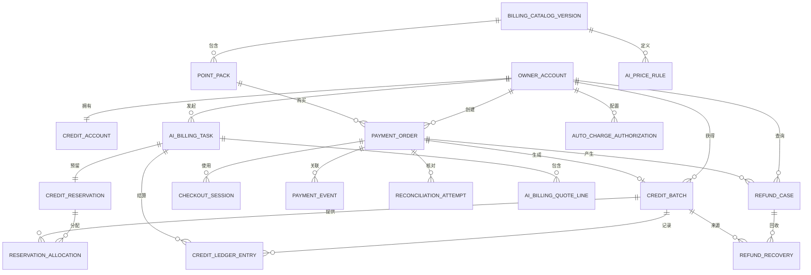

# 阶段 1 数据模型：识海 AI 点数计费与 Waffo 支付

**功能**：`002-ai-credit-billing`

**日期**：2026-10-21

**数据库**：PostgreSQL 18

**实现方式**：Spring Boot 3.x + Java 17；JPA 保存普通实体，`JdbcClient` 执行账本、
预留、批次分配和并发条件更新。Flyway 管理全部迁移。Node Waffo 桥接不连接本数据库。

## 约定

- 主键为服务端生成的 UUID；账本流水 ID 使用 bigint 标识列。
- 时间戳使用 `timestamptz`，以 UTC 存储。
- 所有金额使用人民币最小单位整数 `amount_minor`；所有点数使用整数，不使用浮点数。
- 可变业务行包含 `version integer NOT NULL DEFAULT 1`，用于乐观并发控制。
- 支付与计费数据必须包含不可变 `environment`，取值仅为 `test` 或 `production`。
- 测试与生产必须使用独立物理 PostgreSQL 数据库和独立连接串。每个应用实例启动时以
  `SHIHAI_BILLING_DB_ENV` 校验所连数据库身份；禁止在同一个数据库中仅靠 schema 或行字段隔离
  两套账本。
- `owner_id` 是兼容字段名，语义为账号 ID。它始终来自已认证会话；同一账号独立拥有知识、
  附件、点数、订单、退款和账本，客户端不能提交账号 ID、余额、价格、点率或环境作为权威值。
- 多账号不等于团队：不得提供跨账号知识或点数共享、成员邀请、账号间转赠或团队账本。
- 账本、支付事件和退款结论是只追加事实；账户余额和批次剩余量是可重算投影。
- 不在数据库保存银行卡号、CVC、Waffo 私钥、签名原文、完整通知载荷或用户知识正文。
- 计费表不随知识条目删除级联删除；财务保留至少 24 个月。

## 关系概览



关系图中的 `OWNER_ACCOUNT` 是既有兼容名称，逻辑实体为“账号”；表中的 `owner_id` 同样只是
账号 ID 的兼容字段名。

## 实体：计费目录版本

**用途**：冻结某一生效时间的售价、点率和计费口径。

| 字段 | 类型 | 规则 |
|------|------|------|
| `id` | uuid | 主键 |
| `version_code` | text | 唯一，例如 `2026-10-mvp` |
| `environment` | enum | `test` 或 `production` |
| `status` | enum | `draft`、`scheduled`、`active`、`retired` |
| `effective_at` | timestamptz | 必填 |
| `retired_at` | timestamptz | 可为空 |
| `created_at` | timestamptz | 必填 |

**约束**：

- `UNIQUE(environment, version_code)`。
- 同一环境最多只有一个 `active` 版本。
- 已创建订单和任务必须保存目录版本外键。

## 实体：点数包

**用途**：可购买的识海一次性商品快照。

| 字段 | 类型 | 规则 |
|------|------|------|
| `id` | uuid | 主键 |
| `catalog_version_id` | uuid | 指向计费目录版本，`ON DELETE RESTRICT` |
| `sku` | text | `kb_pack_9`、`kb_pack_29` 或 `kb_pack_99` |
| `name_zh` | text | 中文名称 |
| `name_en` | text | 英文名称 |
| `price_minor` | integer | 正数；单位 CNY 分 |
| `currency` | char(3) | MVP 固定 `CNY` |
| `points` | integer | 正数 |
| `environment` | enum | 与目录版本一致 |
| `status` | enum | `enabled` 或 `disabled` |
| `sort` | integer | 非负 |

**约束**：

- `UNIQUE(catalog_version_id, sku)`。
- SKU 必须使用 `kb_pack_` 前缀，不得复用拾题商品代码。
- `SHIHAI_WAFFO_PRODUCT_MAP` 是供应商商品映射的权威来源；Web 只提交 SKU，桥接返回实际
  `productId`，订单保存该返回值快照。数据库不维护第二份可漂移映射。

## 实体：AI 点率

**用途**：定义每类 AI 功能的计费单位、点数和成功条件。

| 字段 | 类型 | 规则 |
|------|------|------|
| `id` | uuid | 主键 |
| `catalog_version_id` | uuid | 指向计费目录版本 |
| `feature` | enum | 参见计费功能 |
| `unit` | enum | 参见计费单位 |
| `points_per_unit` | integer | 非负；用户可触发功能必须大于 0 |
| `success_rule_code` | text | 受控成功判定代码 |
| `description_zh` | text | 中文说明 |
| `description_en` | text | 英文说明 |

**计费功能**：`classify`、`webpage_vision`、`document_extract`、
`screenshot_ocr`、`internet_search`、`ai_answer`。

**计费单位**：`entry`、`view`、`per_10k_chars`、`image`、`query`、`answer`。

**约束**：`UNIQUE(catalog_version_id, feature)`。

**当前商业点率**：`internet_search` 每 `query` 固定 1 点，`ai_answer` 每成功 `answer`
为 2 点。纯搜索与回答必须是两个独立报价行；组合时报价上限为 3 点。价格变更必须创建新的
目录版本和后续 Flyway 迁移，不得改写已应用迁移或历史报价快照。

## 实体：支付订单

**用途**：表示一次一次性点数包购买及其财务快照。

| 字段 | 类型 | 规则 |
|------|------|------|
| `id` | uuid | 主键 |
| `owner_id` | uuid | 账号 ID（兼容字段名），`ON DELETE RESTRICT` |
| `pack_id` | uuid | 指向点数包快照，`ON DELETE RESTRICT` |
| `sku_snapshot` | text | 订单创建时识海 SKU，跨目录版本保持不变 |
| `catalog_version_id` | uuid | 订单创建时目录版本 |
| `environment` | enum | `test` 或 `production` |
| `amount_minor` | integer | 正数 |
| `currency` | char(3) | 固定 `CNY` |
| `points_snapshot` | integer | 正数 |
| `provider_product_id` | text | 收银台创建后由桥接返回并保存的商品快照 |
| `status` | enum | 参见订单状态机 |
| `checkout_url` | text | 可为空；不得含私钥 |
| `provider_order_id` | text | 可为空 |
| `provider_session_id` | text | 可为空 |
| `paid_at` | timestamptz | 可为空 |
| `closed_at` | timestamptz | 可为空 |
| `refunded_at` | timestamptz | 可为空 |
| `next_check_at` | timestamptz | 待支付/确认中订单下一次主动查询时间 |
| `reconciliation_attempts` | integer | 非负，默认 0 |
| `last_reconciliation_result` | text | 仅安全状态代码，可为空 |
| `idempotency_key` | text | 用户创建订单请求的幂等键 |
| `version` | integer | 乐观并发控制 |
| `created_at` | timestamptz | 必填 |
| `updated_at` | timestamptz | 必填 |

**约束**：

- `UNIQUE(owner_id, idempotency_key)`。
- `UNIQUE(owner_id, environment, sku_snapshot) WHERE status = 'PENDING'`，同一套餐在
  待支付阶段只能存在一笔有效订单，不因目录版本变化而失效。
- `UNIQUE(environment, provider_session_id) WHERE provider_session_id IS NOT NULL`。
- `amount_minor > 0`、`points_snapshot > 0`、`currency = 'CNY'`。
- 已支付订单的 `paid_at` 必填；已关闭订单的 `closed_at` 必填。
- 订单状态进入 `PAID` 后不得回到 `PENDING` 或 `CLOSED`。

**规则**：订单创建后不再读取当前套餐价格重新计算；所有展示、入账和退款使用订单快照。

## 实体：收银台会话

**用途**：记录与本地订单绑定的 Waffo 收银台会话，支持复用与过期。

| 字段 | 类型 | 规则 |
|------|------|------|
| `id` | uuid | 主键 |
| `order_id` | uuid | 指向订单，`ON DELETE RESTRICT` |
| `environment` | enum | 与订单一致 |
| `provider_session_id` | text | Waffo 会话标识 |
| `checkout_url` | text | 短期收银台地址 |
| `status` | enum | `open`、`expired`、`used`、`cancelled` |
| `expires_at` | timestamptz | 必填 |
| `created_at` | timestamptz | 必填 |
| `updated_at` | timestamptz | 必填 |

**约束**：

- `UNIQUE(environment, provider_session_id)`。
- 同一订单同一时刻最多一个 `open` 会话。
- 已过期会话不能再次用于付款，但迟到支付仍可进入订单核验。

## 实体：支付事件

**用途**：保存从 Waffo 通知或主动查询归一化的安全事实。

| 字段 | 类型 | 规则 |
|------|------|------|
| `id` | uuid | 主键 |
| `order_id` | uuid | 可为空；无法匹配订单时为 null，指向人工异常 |
| `environment` | enum | 必填 |
| `source` | enum | `webhook`、`query` |
| `source_event_key` | text | 必填；环境内稳定事件键 |
| `provider_event_id` | text | 通知事件 ID；查询可为空 |
| `delivery_id` | text | 通知投递 ID；查询可为空 |
| `event_type` | text | `paid`、`refund`、`expired`、`conflict` 等受控值 |
| `signature_status` | enum | `valid`、`invalid`、`not_applicable` |
| `normalized_status` | text | 受控状态 |
| `payload_hash` | char(64) | 去除敏感字段后的规范化载荷哈希 |
| `processing_status` | enum | `received`、`applied`、`ignored_duplicate`、`manual_review` |
| `received_at` | timestamptz | 必填 |
| `processed_at` | timestamptz | 可为空 |

**约束**：

- `UNIQUE(environment, source_event_key)`。
- 通知键优先使用 `providerEventId/deliveryId`；查询键使用
  `query:{sessionId}:{normalizedStatus}:{payloadHash}`，相同状态重复查询可去重，状态变化
  会形成新事件。
- 不保存签名、私钥、完整请求体或银行卡相关字段。
- 同一事件只能产生一次订单状态变化。

## 实体：点数账户

**用途**：保存可快速读取的点数投影，权威结果可从批次与账本重算。

| 字段 | 类型 | 规则 |
|------|------|------|
| `owner_id` | uuid | 主键；账号 ID（兼容字段名） |
| `available_points` | integer | 非负投影 |
| `reserved_points` | integer | 非负投影 |
| `trial_points` | integer | 非负投影 |
| `purchased_points` | integer | 非负投影 |
| `lifetime_granted` | integer | 非负 |
| `lifetime_settled` | integer | 非负 |
| `version` | integer | 乐观并发控制 |
| `updated_at` | timestamptz | 必填 |

**约束**：

- `available_points >= 0`、`reserved_points >= 0`。
- `available_points = trial_points + purchased_points - reserved_points` 必须在同一事务中
  保持一致。
- 任何直接减少 `available_points` 而不写账本的操作都禁止。

## 实体：点数批次

**用途**：追踪体验点或某支付订单产生的点数来源。

| 字段 | 类型 | 规则 |
|------|------|------|
| `id` | uuid | 主键 |
| `owner_id` | uuid | 账号 ID（兼容字段名） |
| `source_type` | enum | `trial`、`purchase`、`manual_adjustment` |
| `order_id` | uuid | 购买批次必填；其他来源为空 |
| `environment` | enum | 必填 |
| `initial_points` | integer | 正数 |
| `remaining_points` | integer | 非负 |
| `reserved_points` | integer | 非负 |
| `status` | enum | `active`、`frozen`、`depleted`、`closed` |
| `priority_at` | timestamptz | 消费排序时间 |
| `expires_at` | timestamptz | 可为空；MVP 购买点为空 |
| `version` | integer | 乐观并发控制 |
| `created_at` | timestamptz | 必填 |
| `updated_at` | timestamptz | 必填 |

**约束**：

- `UNIQUE(order_id) WHERE source_type = 'purchase'`。
- `remaining_points >= 0`、`reserved_points >= 0`。
- `remaining_points >= reserved_points`。
- 体验点批次在同一账号中最多一个未关闭记录。
- 退款只能冻结与目标订单关联的购买批次。

## 实体：账本明细

**用途**：只追加记录所有点数事实。

| 字段 | 类型 | 规则 |
|------|------|------|
| `id` | bigint | 标识列主键 |
| `owner_id` | uuid | 账号 ID（兼容字段名） |
| `batch_id` | uuid | 可为空；账户级调整可为空 |
| `entry_scope` | enum | `account` 或 `batch` |
| `operation_type` | enum | 见下 |
| `available_delta` | integer | 可用余额变化 |
| `reserved_delta` | integer | 冻结余额变化 |
| `consumed_delta` | integer | 已消费余额变化 |
| `available_after` | integer | 非负 |
| `reserved_after` | integer | 非负 |
| `reference_type` | text | `order`、`ai_task`、`refund`、`adjustment` |
| `reference_id` | text | 关联业务标识 |
| `environment` | enum | 必填 |
| `metadata_safe` | jsonb | 仅安全状态和原因代码 |
| `created_at` | timestamptz | 必填 |

**操作类型**：`trial_grant`、`purchase_grant`、`reserve`、`reserve_release`、
`settle`、`refund_recover`、`manual_adjustment`。

**约束**：

- 批次分录：`UNIQUE(operation_type, reference_type, reference_id, batch_id)
  WHERE batch_id IS NOT NULL`。
- 账户级人工调整：`UNIQUE(operation_type, reference_type, reference_id)
  WHERE batch_id IS NULL`。
- 账本行不得更新或删除；人工修正必须新增相反方向的 `manual_adjustment`。
- `metadata_safe` 不得含签名、支付载荷、知识正文或用户隐私。

**分录语义**：

| 操作 | `available_delta` | `reserved_delta` | `consumed_delta` |
|------|-------------------|------------------|------------------|
| 体验点/购买点发放 | `+points` | `0` | `0` |
| 预留 | `-points` | `+points` | `0` |
| 结算 | `0` | `-points` | `+points` |
| 释放 | `+points` | `-points` | `0` |
| 退款回收 | `-points` | `0` | `0` |
| 人工调整 | 明确正负 | 明确正负 | 明确正负 |

余额必须可由账本分录和批次发放记录重算。迁移时禁止用单一无方向 `delta` 代替上述字段。

## 实体：AI 计费任务

**用途**：表示一次报价、预留与结算闭环。

| 字段 | 类型 | 规则 |
|------|------|------|
| `id` | uuid | 主键 |
| `owner_id` | uuid | 账号 ID（兼容字段名） |
| `job_id` | uuid | 可空；关联 001 的采集/处理任务 |
| `item_id` | uuid | 可空；关联知识条目 |
| `catalog_version_id` | uuid | 报价使用目录版本 |
| `status` | enum | 参见任务状态机 |
| `max_points` | integer | 正数，不得超过目录规则和用户确认上限 |
| `settled_points` | integer | 非负，不得超过 `max_points` |
| `auto_authorization_id` | uuid | 自动任务必填；手动任务为空 |
| `idempotency_key` | text | 新执行必须新键 |
| `expires_at` | timestamptz | 默认不超过创建后 30 分钟 |
| `confirmed_at` | timestamptz | 手动任务必填 |
| `version` | integer | 乐观并发控制 |
| `created_at` | timestamptz | 必填 |
| `updated_at` | timestamptz | 必填 |

**约束**：

- `UNIQUE(owner_id, idempotency_key)`。
- 同一幂等键不同请求哈希返回冲突。
- 已成功结算的任务只能通过新幂等键重新执行。
- 过期未结算任务进入 `EXPIRED`，迟到结果不得追加扣费。

## 实体：AI 报价行

**用途**：展示组合任务的分项计费。

| 字段 | 类型 | 规则 |
|------|------|------|
| `id` | uuid | 主键 |
| `billing_task_id` | uuid | 指向 AI 计费任务 |
| `feature` | enum | 与目录版本中的 AI 点率一致 |
| `quantity` | integer | 正数 |
| `unit_points` | integer | 报价快照 |
| `max_line_points` | integer | `quantity * unit_points` |
| `success_state` | enum | `pending`、`succeeded`、`failed`、`skipped` |
| `settled_points` | integer | 非负 |

**约束**：

- 任务内功能唯一。
- `settled_points <= max_line_points`。
- 所有报价行 `max_line_points` 之和等于任务 `max_points`。

## 实体：AI 报价图片资源

**用途**：保存用户明确选择分析、并由服务端解析后的唯一安全图片资源，防止同一内容重复计费。

| 字段 | 类型 | 规则 |
|------|------|------|
| `id` | uuid | 主键 |
| `billing_task_id` | uuid | 指向 AI 计费任务，`ON DELETE CASCADE` |
| `asset_id` | uuid | 请求中选中的安全 upload/attachment ID |
| `content_hash` | char(64) | 规范化且已安全处理图片的 SHA-256 |
| `media_type` | text | 规范化 MIME |
| `normalized_size_bytes` | bigint | 非负 |
| `counted_quantity` | integer | 固定为 1 |
| `created_at` | timestamptz | 必填 |

**约束**：

- `UNIQUE(billing_task_id, content_hash)`；不同 asset 指向同一内容时只保留一个计费资源。
- 资产必须属于同一账号，处于可安全分析状态，且报价请求明确选择了该资产。
- 报价响应只返回 `assetId`、内容哈希、媒体类型和大小，不返回存储键、URL 或图片内容。
- `screenshot_ocr` 与正文图片 OCR/vision 的数量按唯一资源行计算；正文重复引用不增加数量。

## 实体：点数预留

**用途**：冻结一个 AI 任务的费用上限。

| 字段 | 类型 | 规则 |
|------|------|------|
| `id` | uuid | 主键 |
| `billing_task_id` | uuid | 唯一外键 |
| `owner_id` | uuid | 账号 ID（兼容字段名） |
| `status` | enum | `reserved`、`settling`、`settled`、`releasing`、`released`、`expired`、`manual_review` |
| `reserved_points` | integer | 正数 |
| `settled_points` | integer | 非负 |
| `released_points` | integer | 非负 |
| `deadline_at` | timestamptz | 必填 |
| `version` | integer | 乐观并发控制 |
| `created_at` | timestamptz | 必填 |
| `updated_at` | timestamptz | 必填 |

**约束**：

- `reserved_points = settled_points + released_points` 仅在终态成立。
- `settled_points + released_points <= reserved_points` 在过程中成立。
- 同一任务最多一个预留。

## 实体：预留批次分配

**用途**：记录一个预留从哪些批次冻结多少点数。

| 字段 | 类型 | 规则 |
|------|------|------|
| `id` | uuid | 主键 |
| `reservation_id` | uuid | 指向预留 |
| `batch_id` | uuid | 指向点数批次 |
| `status` | enum | `active`、`refund_hold`、`settled`、`released` |
| `reserved_points` | integer | 正数 |
| `settled_points` | integer | 非负 |
| `released_points` | integer | 非负 |

**约束**：

- `UNIQUE(reservation_id, batch_id)`。
- 分配总额等于预留总额。
- 结算和释放不得超过该批次分配额。

## 实体：自动扣点授权

**用途**：独立于 AI 隐私授权，控制自动整理是否可扣点。

| 字段 | 类型 | 规则 |
|------|------|------|
| `id` | uuid | 主键 |
| `owner_id` | uuid | 账号 ID（兼容字段名） |
| `feature_scope` | enum | MVP 主要为 `classify` |
| `enabled` | boolean | 默认 false |
| `max_points_per_task` | integer | 默认 15，范围 1–100 |
| `max_points_per_day` | integer | 默认 100，范围 1–500 |
| `timezone` | text | 默认 `Asia/Shanghai` |
| `consent_text_version` | text | 必填 |
| `effective_at` | timestamptz | 必填 |
| `revoked_at` | timestamptz | 可为空 |
| `version` | integer | 乐观并发控制 |

**约束**：同一账号、功能范围最多一个 active 授权。

## 实体：每日自动消费额度

**用途**：为每日自动扣点上限提供并发安全的投影。

| 字段 | 类型 | 规则 |
|------|------|------|
| `id` | uuid | 主键 |
| `owner_id` | uuid | 账号 ID（兼容字段名） |
| `usage_date` | date | 按用户时区计算 |
| `auto_reserved_points` | integer | 非负 |
| `auto_settled_points` | integer | 非负 |
| `updated_at` | timestamptz | 必填 |

**约束**：`UNIQUE(owner_id, usage_date)`。

## 实体：退款案例

**用途**：记录退款核验、回收和人工结论。

| 字段 | 类型 | 规则 |
|------|------|------|
| `id` | uuid | 主键 |
| `order_id` | uuid | 指向订单 |
| `environment` | enum | 与订单一致 |
| `status` | enum | `noticed`、`verifying`、`waiting_task_settlement`、`recovering`、`recovered`、`partially_recovered`、`rejected`、`manual_review` |
| `provider_refund_id` | text | 必填；Waffo 退款事件或安全派生退款键 |
| `refund_amount_minor` | integer | 非负 |
| `expected_recovery_points` | integer | 非负 |
| `recovered_points` | integer | 非负 |
| `unrecovered_points` | integer | 非负 |
| `reason_code` | text | 受控值 |
| `review_owner` | text | 人工复核时必填 |
| `review_due_at` | timestamptz | 人工复核默认 3 个工作日 |
| `resolution_note_safe` | text | 不含支付敏感信息 |
| `version` | integer | 乐观并发控制 |
| `created_at` | timestamptz | 必填 |
| `resolved_at` | timestamptz | 最终状态下必填 |

**约束**：

- 同一 Waffo 退款事件只能创建一个有效退款案例。
- `UNIQUE(environment, provider_refund_id)`。
- `recovered_points <= expected_recovery_points`。
- 最终状态必须有 `resolved_at` 和安全结论。

## 实体：退款回收

**用途**：记录退款从点数批次回收的具体数量。

| 字段 | 类型 | 规则 |
|------|------|------|
| `id` | uuid | 主键 |
| `refund_case_id` | uuid | 指向退款案例 |
| `batch_id` | uuid | 指向原订单批次 |
| `points` | integer | 正数 |
| `status` | enum | `reserved`、`recovered`、`failed` |
| `created_at` | timestamptz | 必填 |
| `recovered_at` | timestamptz | 可为空 |

**约束**：`UNIQUE(refund_case_id, batch_id)`。

## 实体：对账尝试

**用途**：记录主动查询未决订单的次数、结果和下一次时间。

| 字段 | 类型 | 规则 |
|------|------|------|
| `id` | uuid | 主键 |
| `order_id` | uuid | 指向订单 |
| `environment` | enum | 与订单一致 |
| `attempt_number` | integer | 从 1 递增 |
| `result` | enum | `pending`、`paid`、`closed`、`refunded`、`mismatch`、`unavailable` |
| `error_code` | text | 仅安全代码 |
| `next_check_at` | timestamptz | 可为空 |
| `checked_at` | timestamptz | 必填 |

**约束**：`UNIQUE(order_id, attempt_number)`。

## 实体：计费异常

**用途**：保存无法自动处理的支付、扣费、退款或对账事实。

| 字段 | 类型 | 规则 |
|------|------|------|
| `id` | uuid | 主键 |
| `owner_id` | uuid | 可为空；账号 ID（兼容字段名） |
| `order_id` | uuid | 可为空 |
| `billing_task_id` | uuid | 可为空 |
| `refund_case_id` | uuid | 可为空 |
| `category` | enum | `payment_conflict`、`amount_mismatch`、`environment_mismatch`、`reservation_timeout`、`refund_review`、`ledger_mismatch` |
| `status` | enum | `open`、`in_review`、`resolved`、`rejected` |
| `safe_details` | jsonb | 仅状态、原因代码和非敏感标识 |
| `assigned_to` | text | 可为空 |
| `due_at` | timestamptz | 必填 |
| `created_at` | timestamptz | 必填 |
| `resolved_at` | timestamptz | 可为空 |

## 状态机

### 支付订单

```text
PENDING -> CONFIRMING -> PAID
PENDING -> CLOSED
CONFIRMING -> EXCEPTION
PAID -> REFUNDING -> REFUNDED
PAID -> EXCEPTION
```

- `PENDING` 可复用同一收银台会话。
- `CONFIRMING` 表示通知或查询已到达但尚未完成安全核验。
- `PAID` 是首次可靠支付事实，后续相反状态不能自动撤销。
- 关闭后收到可核验迟到支付时，可进入 `CONFIRMING -> PAID`；确认事务必须原子关闭同
  SKU 的其他 `PENDING` 订单和开放收银台会话，再为迟到订单入账。

### AI 计费任务

```text
QUOTED -> CONFIRMED -> RESERVED -> RUNNING -> SETTLED
QUOTED -> EXPIRED
CONFIRMED -> EXPIRED
QUOTED -> CANCELLED
CONFIRMED -> INSUFFICIENT
RESERVED -> RUNNING -> RELEASED
RESERVED/RUNNING -> EXPIRED
RUNNING -> MANUAL_REVIEW
```

- 只有 `CONFIRMED` 且余额足够才能进入 `RESERVED`。
- `SETTLED` 的实际点数不得超过报价上限。
- `EXPIRED` 后迟到结果不得再次扣费。

### 点数预留

```text
reserved -> settling -> settled
reserved -> releasing -> released
reserved/settling -> expired
settling/releasing -> manual_review
```

### 点数批次

```text
active -> frozen -> active
active/frozen -> depleted
active/frozen -> closed
```

- `frozen` 不再接受新预留，已有预留可完成结算。
- 剩余量为 0 时进入 `depleted`。
- 退款完成且无可回收点数时进入 `closed`。

### 退款案例

```text
noticed -> verifying -> waiting_task_settlement -> recovering -> recovered
                               -> partially_recovered
verifying -> manual_review -> recovered/partially_recovered/rejected
```

## 必需索引

- 点数账户：主键 `owner_id`。
- 点数批次消费：`(owner_id, status, priority_at ASC)`。
- 订单列表：`(owner_id, created_at DESC)`、`(status, updated_at)`。
- 收银台复用过期：`(order_id, status, expires_at)`。
- 支付事件去重：`(environment, provider_event_id, delivery_id)`。
- 对账扫描：`(status, next_check_at)` 和未决订单的部分索引。
- 账本查询：`(owner_id, created_at DESC)`、`(reference_type, reference_id)`。
- AI 任务：`(owner_id, created_at DESC)`、`(status, expires_at)`。
- 每日额度：`(owner_id, usage_date)`。
- 退款复核：`(status, review_due_at)`。
- 计费异常：`(status, due_at)`。

## 关键事务

### 支付到账

1. 锁定订单和支付事件。
2. 校验环境、金额、币种、商品、会话和签名/查询来源。
3. 若订单已支付，返回幂等结果。
4. 将订单标记为 `PAID` 并设置 `paid_at`。
5. 创建订单唯一购买批次。
6. 更新点数账户投影并追加入账账本。
7. 标记事件已应用。

**原子要求**：步骤 4 至 6 必须处于同一事务。

### AI 预留

1. 锁定账户和每日额度。
2. 依据报价与授权计算最大费用。
3. 按体验点、购买点最早批次分配。
4. 写入预留、批次分配和账本。
5. 将任务标记为 `RESERVED`。

**原子要求**：余额不足时整个事务回滚，不产生任何冻结或消费明细。

纯互联网搜索的用户单击“互联网搜索 · 1 点”即视为确认本次报价。客户端必须在一次操作中
创建并确认报价后调用搜索；服务端仍保留 `QUOTED -> CONFIRMED -> RESERVED` 事实。不得因
自动确认而省略报价版本、幂等键或 1 点上限校验，也不得在界面追加搜索二次确认。

### 任务结算或释放

1. 锁定任务、预留和分配行。
2. 校验终态和幂等引用。
3. 按成功步骤计算最终点数，且不超过上限。
4. 结算已消费批次，释放未消费批次。
5. 更新账户、批次、账本和任务终态。

### 退款

1. 锁定订单、退款案例和原购买批次。
2. 冻结批次的新预留。
3. 取消未开始任务并释放预留。
4. 将运行中任务的批次分配标记为 `refund_hold`，等待任务结算或释放。
5. 未开始任务立即回收；仍有运行任务的退款案例进入 `waiting_task_settlement`。
6. 每个运行任务结束后，将新释放点数继续回收到同一退款案例。
7. 所有任务结束后回收批次剩余未使用点数，记录已消费、未回收和人工复核部分。

## 保留与删除

| 数据 | 默认保留 |
|------|----------|
| 支付订单 | 至少 24 个月 |
| 支付事件 | 至少 24 个月 |
| 点数批次与账本 | 至少 24 个月 |
| 退款案例与回收 | 至少 24 个月 |
| 对账尝试 | 至少 24 个月 |
| 计费异常 | 至少 24 个月 |
| 自动扣点授权历史 | 账户存续期间 |

订单和账本不得因知识条目、采集任务或账号普通业务数据删除而级联消失。若未来需要删除
账户，必须另行定义财务保留、匿名化和法定删除规则。

## 关键不变量

1. 客户端不能决定套餐价格、点率、扣费额、余额或支付环境。
2. 同一支付订单最多生成一个购买批次。
3. 同一业务操作最多产生一条有效账本变化。
4. 任何事务结束时可用余额和批次剩余量不得为负。
5. 任务结算总额不得超过确认报价上限。
6. 退款只能回收原订单批次中尚未使用的点数。
7. 测试事件不得进入生产订单或账本。
8. 首次可靠支付事实不得被后续相反事件自动撤销。
9. 过期任务的迟到结果不得产生新扣费。
10. 支付、账本和退款证据不得包含真实密钥、签名原文或完整支付载荷。
11. 所有订单、批次、预留、账本、退款和自动扣点授权只对所属账号可见和可操作；跨账号引用
    必须视为无效或安全拒绝。
12. 纯互联网搜索的报价快照和结算点数均为 1 点；搜索与 AI 回答组合时，两行上限之和为 3 点，
    不得把 1 点搜索任务扩大为 3 点纯搜索任务。

## 当前实现映射（2026-10-22）

- 计费主迁移实际为 `V0009__billing.sql`，不是早期任务草案中的 `V0002__billing.sql`；任务表与
  部署文档已同步到 V0009。
- `V0013__api_idempotency.sql` 提供服务端请求哈希和安全响应重放，供 AI 导入与计费治理共用。
- `V0014__billing_environment_guard.sql` 在物理数据库中写入唯一环境标识；应用启动时若
  `SHIHAI_APP_ENV` 与数据库标识不一致必须失败。
- 将 `internet_search` 从历史 3 点调整为 1 点必须新增后续迁移，例如
  `V0015__internet_search_one_point.sql`；不得修改生产已应用的 `V0009__billing.sql`。
- 管理员点数调整请求必须显式携带 `targetOwnerId`；信用调整新增 manual batch，扣减调整按
  体验点优先、购买点最早批次顺序消费并逐批次写只追加账本。
- 退款结论以实际可回收批次点数为准，客户端提交的 recovered/unrecovered 数值只作为请求
  结构兼容字段，不作为账务权威。
