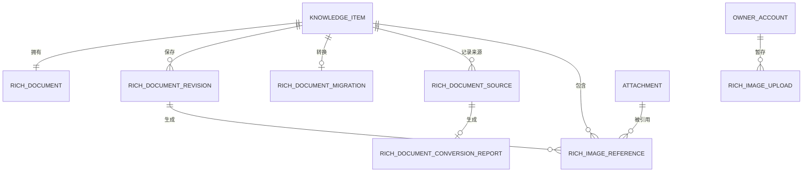

# 阶段 1 数据模型：识海富文本知识编辑

**功能**：`004-rich-text-editor`

**日期**：2026-10-21

**数据库**：PostgreSQL 18

**实现方式**：Vue 3 + Tiptap 生成 ProseMirror JSON；Spring Boot 使用 Jackson、JSON Schema
和 Java 领域验证器复验。普通实体由 JPA 保存，文档事务、引用解析和搜索修订使用
`JdbcClient`。

## 约定

- 沿用 001 的 `knowledge_item`、`attachment`、搜索修订和所有者模型。
- 结构化正文使用版本化 JSONB；纯文本投影用于搜索和 AI，不是正文权威。
- 图片引用只指向已完成扫描和脱敏的附件。
- 版本、内容哈希和引用操作必须可重建。
- 时间戳使用 `timestamptz`，以 UTC 存储。

## 关系概览



## 实体：富文本文档

**用途**：保存知识条目的当前结构化正文和派生投影。

| 字段 | 类型 | 规则 |
|------|------|------|
| `item_id` | uuid | 主键，指向 `knowledge_item`，`ON DELETE CASCADE` |
| `schema_version` | integer | 正整数，MVP 从 `1` 开始 |
| `document` | jsonb | 通过 [rich-text.schema.json](contracts/rich-text.schema.json) 验证 |
| `plain_text` | text | 服务端从文档重建，最大 200,000 字符 |
| `document_hash` | char(64) | 规范化文档的 SHA-256 |
| `image_count` | integer | 0–20 |
| `total_image_bytes` | bigint | 0–52,428,800 |
| `sanitized_at` | timestamptz | 最近一次 schema 验证和清洗时间 |
| `version` | integer | 与 `knowledge_item.version` 同事务同步的镜像，不作为客户端锁 |
| `created_at` | timestamptz | 必填 |
| `updated_at` | timestamptz | 必填 |

**约束**：

- `image_count BETWEEN 0 AND 20`。
- `total_image_bytes BETWEEN 0 AND 52428800`。
- `plain_text` 的长度不得超过 200,000 个字符。
- `document_hash` 必须与实际规范化文档匹配。
- `knowledge_item.body` 是 `rich_document.plain_text` 的只读兼容投影，两者必须完全一致。
- 唯一客户端乐观锁令牌是 `knowledge_item.version`；API 的 `expectedVersion` 只针对该字段。
- 保存文档、引用、纯文本投影和 `knowledge_item.search_revision` 必须在同一事务。
- 表格首行必须全部为 `tableHeader`，其余行必须全部为 `tableCell`；不允许后续行再次出现表头单元格。

## 实体：富文本修订

**用途**：保留有限窗口的正文修订，支持冲突审计和恢复。

| 字段 | 类型 | 规则 |
|------|------|------|
| `id` | uuid | 主键 |
| `item_id` | uuid | 指向知识条目 |
| `revision_no` | integer | 从 1 递增 |
| `schema_version` | integer | 必填 |
| `document` | jsonb | 已验证快照 |
| `plain_text` | text | 派生快照 |
| `document_hash` | char(64) | 必填 |
| `reason` | enum | `create`、`edit`、`migration`、`conflict_overwrite` |
| `source_id` | uuid | 可为空，指向本条的来源记录 |
| `created_at` | timestamptz | 必填 |

**约束**：`UNIQUE(item_id, revision_no)`。

**保留**：默认保留最近 90 天，永久删除遵循 001 的条目清除流程。

## 实体：富文本图片引用

**用途**：把正文图片节点映射到可清理和可审计的安全附件。

| 字段 | 类型 | 规则 |
|------|------|------|
| `id` | uuid | 主键 |
| `item_id` | uuid | 指向知识条目 |
| `revision_id` | uuid | 指向生成该引用的富文本修订，`ON DELETE CASCADE` |
| `attachment_id` | uuid | 指向 `attachment`，`ON DELETE RESTRICT` |
| `node_id` | text | 文档内稳定节点 ID |
| `asset_id` | uuid | 已解析的正式附件 ID；持久化文档的 `assetId` 必须等于该值 |
| `alt_text` | text | 最大 500 字符；装饰图片可为空 |
| `caption` | text | 最大 500 字符，可为空 |
| `display_width_px` | integer | 80–1600 |
| `alignment` | enum | `left`、`center`、`right` |
| `status` | enum | `active`、`removed`、`cleanup_pending` |
| `created_at` | timestamptz | 必填 |
| `updated_at` | timestamptz | 必填 |

**约束**：

- `UNIQUE(revision_id, node_id)`。
- 持久化文档中的图片 `assetId` 必须等于 `asset_id`，不得保留临时 `uploadId`。
- 同一当前修订内的 `node_id` 不能同时指向不同 active 附件；历史修订可以保留旧附件引用。
- 附件必须属于同一所有者，且 `scan_state=clean`；需要脱敏时必须引用派生脱敏图。
- `data:`、`blob:`、远程 URL 和未扫描附件不得成为图片引用。

## 实体：富文本图片上传

**用途**：为尚无已保存知识条目的编辑器提供所有者级安全暂存。

| 字段 | 类型 | 规则 |
|------|------|------|
| `id` | uuid | 主键，也是编辑器临时 `assetId` |
| `owner_id` | uuid | 指向所有者 |
| `item_id` | uuid | 可为空；进入正式文档前绑定 |
| `storage_key` | text | 临时私有对象键，不进入正文 |
| `media_type` | text | 规范化后的 MIME |
| `source_size_bytes` | bigint | 原始源文件大小；0–26,214,400 |
| `size_bytes` | bigint | 处理后文件大小 |
| `content_hash` | char(64) | 规范化且已安全处理图片的 SHA-256，用于所有权校验和 AI 唯一计费 |
| `normalized_width` | integer | 正数 |
| `normalized_height` | integer | 正数 |
| `scan_state` | enum | `pending`、`clean`、`rejected` |
| `redaction_state` | enum | `pending`、`none`、`redacted`、`rejected` |
| `status` | enum | `staged`、`scanning`、`ready`、`rejected`、`attached`、`expired` |
| `expires_at` | timestamptz | 默认创建后 24 小时 |
| `created_at` | timestamptz | 必填 |
| `updated_at` | timestamptz | 必填 |

**规则**：

- 只有 `status=ready`、`scan_state=clean` 且 `redaction_state IN ('none','redacted')` 的
  upload 可被引用。
- `source_size_bytes <= 26,214,400`；处理后单图必须有且只有一个 `content_hash`。
- 保存时，服务端把 ready upload 提升为带 `item_id` 的正式附件，再把文档中的临时 `assetId`
  解析为正式 `attachmentId`。
- 保存响应和后续读取返回正式附件 ID；临时 `uploadId` 不进入持久化文档。
- 未完成保存的 upload 到期清理，不进入知识条目或永久附件集合。
- upload 不得跨所有者或环境使用。

## 实体：富文本迁移状态

**用途**：让旧条目在尚未创建 `rich_document` 时也能被发现、重试和核对。

| 字段 | 类型 | 规则 |
|------|------|------|
| `item_id` | uuid | 主键，指向知识条目 |
| `status` | enum | `pending`、`running`、`migrated`、`failed` |
| `attempt_count` | integer | 非负 |
| `source_hash` | char(64) | 旧纯文本哈希 |
| `error_code` | text | 安全错误代码，可为空 |
| `started_at` | timestamptz | 可为空 |
| `finished_at` | timestamptz | 可为空 |
| `updated_at` | timestamptz | 必填 |

**状态机**：`pending -> running -> migrated`，或 `running -> failed -> pending`。

`knowledge_item.body_migration_state` 是 API 过渡状态：`pending/failed` 时返回
`bodyDocument=null` 并只读展示纯文本 `body`；迁移成功后进入 `completed/not_required`，才允许
富文本编辑。迁移状态表仍是任务发现和重试的权威。

## 实体：富文本来源记录

**用途**：保留结构化内容的来源和转换依据。

| 字段 | 类型 | 规则 |
|------|------|------|
| `id` | uuid | 主键 |
| `item_id` | uuid | 指向知识条目 |
| `source_kind` | enum | `native`、`clipboard`、`word`、`google_docs`、`webpage`、`document`、`screenshot`、`legacy_text`、`internet_result` |
| `source_url` | text | 可为空；只保存清理后的 HTTP/HTTPS URL |
| `source_host` | text | 可为空 |
| `captured_at` | timestamptz | 外部内容必填 |
| `converted_at` | timestamptz | 必填 |
| `converter_version` | text | 必填 |
| `content_hash` | char(64) | 转换前安全内容哈希 |
| `conversion_report_id` | uuid | 可为空，指向本次转换报告 |
| `created_at` | timestamptz | 必填 |

**规则**：

- 不保存完整剪贴板、Cookie、Authorization 头、远程图片二进制或含凭据 URL。
- 每次成功粘贴、网页/文档转换和旧文本迁移都必须写入来源记录；`captured_at`、
  `converted_at`、`converter_version` 和 `content_hash` 不得为空。
- `webpage` 来源必须有清理后的 `source_url`；`clipboard`、`word`、`google_docs`、
  `document`、`screenshot` 和 `internet_result` 必须有 `captured_at`。
- `source_url` 只允许清理后的 HTTP/HTTPS URL；拒绝内嵌凭据、控制字符、`javascript:`、
  `data:`、`file:`、`blob:` 和本机/私网目标。
- 转换失败不创建成功来源记录，只保留安全任务错误；重试不得覆盖既有成功记录。

## 实体：富文本转换报告

**用途**：记录一次外部内容或旧文本到受限 schema 的格式转换结果，供用户提示和审计。

| 字段 | 类型 | 规则 |
|------|------|------|
| `id` | uuid | 主键 |
| `source_id` | uuid | 指向本条富文本来源，`ON DELETE CASCADE` |
| `preserved_features` | text[] | 如 `heading`、`list`、`link`、`table` |
| `downgraded_features` | text[] | 保留文字但降级为默认语义的格式 |
| `removed_features` | text[] | 被移除的危险或不支持格式 |
| `rejected_features` | text[] | 因安全原因整项拒绝的来源内容 |
| `converter_version` | text | 必须与来源记录一致 |
| `created_at` | timestamptz | 必填 |

**约束**：`source_id` 唯一；feature 名称来自受控词表，不保存原始 HTML、选择器或用户内容。

## 与 001 实体集成

| 001 实体 | 关系 | 规则 |
|----------|------|------|
| `knowledge_item` | 1:1 富文本文档 | `body` 继续保存纯文本投影，`rich_document.document` 保存格式 |
| `attachment` | 1:N 图片引用 | 仅 clean/redacted 附件可被 active 引用 |
| `processing_job` | 无直接依赖 | 自动 AI 导入先创建纯文本，再安全生成默认段落文档 |
| 搜索索引 | 投影 | 索引文本来自 `plain_text`，图片说明和替代文本附加到投影 |
| AI 输入 | 投影 | 不发送 JSON 结构和附件存储键 |

图片 AI 分析时，004 只向 002 提供去重后的安全资产标识；002 解析后按 `content_hash` 生成唯一
资源清单并报价。同一图片重复出现在一个或多个节点中只计一次，临时 `uploadId` 必须在保存或
计费前解析为当前所有者可用的安全资产。

## 状态与转换

### 富文本保存

```text
editing -> validating -> resolving_image_uploads -> committing -> saved
                      -> validation_failed
                      -> image_rejected
                      -> version_conflict
```

- 任一图片拒绝会阻止本次文档版本写入。
- 版本冲突不覆盖当前文档。

### 旧数据迁移

```text
pending -> running -> migrated
pending -> running -> failed -> pending （重试）
```

迁移必须幂等，以纯文本内容哈希和 `version` 条件更新。
迁移完成后 `knowledge_item.body` 必须与 `rich_document.plain_text` 逐字一致。

## 图片配额与格式

- 每知识最多 20 张图片。
- 单图源文件 ≤25 MiB，处理后图片合计 ≤50 MiB。
- 每边 ≤8192 像素，总解码像素 ≤40,000,000。
- 支持 JPEG、PNG、WebP、HEIC/HEIF 的静态规范化；动画静态化或拒绝。
- 去除不必要 EXIF/XMP；保留可见方向。
- 密钥图片只保留可靠脱敏派生图。

## 索引与清理

- 文档：主键 `item_id`、`updated_at`。
- 修订：`(item_id, revision_no DESC)`、`created_at`。
- 迁移：`(status, updated_at)`。
- 图片引用：`(item_id, status)`、`(revision_id, node_id)`、`(attachment_id, status)`。
- 图片上传：`(owner_id, status, expires_at)`。
- 图片去重：`(owner_id, content_hash, status)`，仅用于同一所有者的唯一计费与重复提示。
- 来源：`(item_id, created_at DESC)`；转换报告：唯一 `source_id`。
- 冲突/搜索：唯一搜索修订计数器来自 `knowledge_item.search_revision`。
- 删除图片节点后引用进入 `cleanup_pending`；无其他保留引用时由清理任务删除派生对象。
- 知识条目进入回收站时，图片引用仍保留；永久清除后按 001 生命周期处理。

## 关键不变量

1. 只有结构化文档是正文权威，原始粘贴 HTML 不得持久化。
2. 文档、纯文本、图片引用和搜索修订在同一事务提交。
3. 图片没有完整安全状态时，知识版本不得保存。
4. 搜索与 AI 不读取内部 JSON 标记、附件存储键或脚本。
5. 旧纯文本转换幂等且不丢换行。
6. 版本冲突不静默覆盖。
7. 图片引用与附件生命周期保持一致。
8. `knowledge_item.version` 是唯一客户端乐观锁；`rich_document.version` 只是同步镜像。
9. 旧条目在迁移前通过独立迁移状态表发现和重试。
10. 编辑器图片只能经所有者级暂存上传进入，不能提前创建正式知识条目。
11. 持久化正文中的图片 `assetId` 必须是正式附件 ID，临时 upload ID 不得落盘。
12. 每次粘贴、外部转换或旧文本迁移必须具有来源和转换报告，来源 URL 必须已清理。
13. 同一规范化图片内容在同一 AI 报价中只能计费一次。
